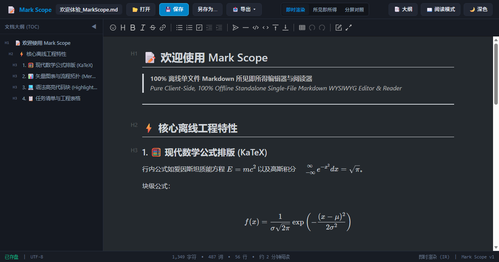
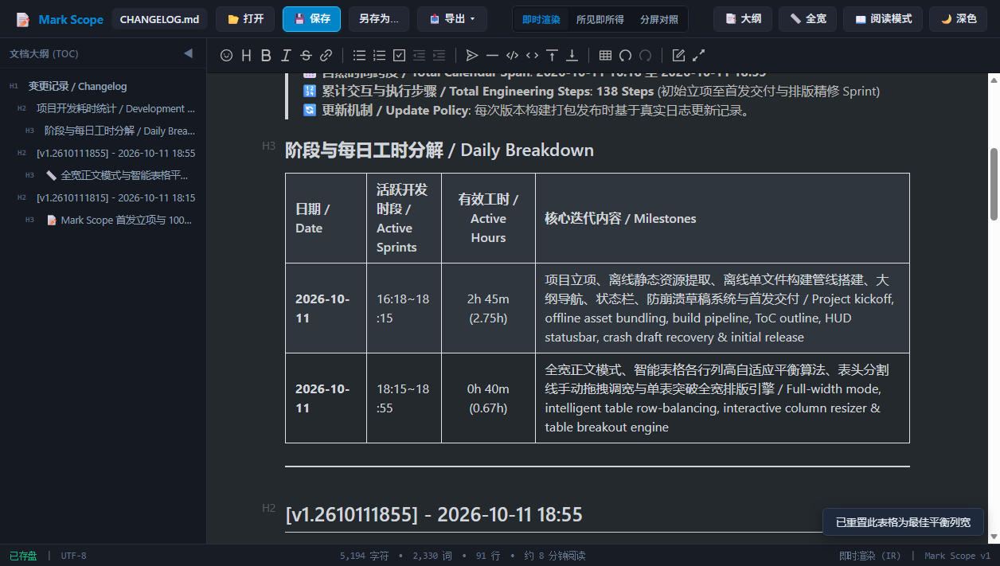

# 📝 Mark Scope

> 🌐 **在线即刻体验 / Live Web App (GitHub Pages)**: [https://wwbim.github.io/Mark-Scope/](https://wwbim.github.io/Mark-Scope/)  
> 📦 **单文件直接访问 / Direct Single-File Access**: [https://wwbim.github.io/Mark-Scope/Deliverables/MarkScope.html](https://wwbim.github.io/Mark-Scope/Deliverables/MarkScope.html)  
> 💾 **100% 离线单文件自包含 Markdown 所见即所得编辑器与阅读器**  
> 💾 **100% Pure Client-Side Offline Standalone Markdown WYSIWYG Editor & Reader**

---

## 📖 项目简介 / Introduction

**Mark Scope** 是与 **BIM Scope** 秉承相同极客理念的姊妹工程，致力于提供一个**零服务端依赖 (Zero-Server)、100% 纯客户端、单文件自包含 (Standalone Single HTML)** 的现代化 Markdown 编辑与阅读工具。  
**Mark Scope** is the sister project of **BIM Scope**, adhering to the same engineering philosophy: delivering a modern Markdown editor and reader that is **100% pure client-side, zero-server dependent, and completely self-contained in a single HTML file**.

无需任何本地安装或后端服务，双击单个 `MarkScope.html` 文件，即可在任意现代浏览器中离线启动运行；全程不发起任何外部网络请求，在兼顾极致便携性的同时，确保工程文档的 100% 私密性与数据安全。  
Requiring no installation or backend services, simply double-clicking the standalone `MarkScope.html` file opens it in any modern web browser. It executes 100% offline with zero external network requests, ensuring maximum portability, uncompromising privacy, and absolute data sovereignty.

---

## 🖼️ 界面预览 / UI Previews

### 1. 现代化暗黑工程编辑界面与实时大纲 / Dark Engineering Workspace & Live ToC Outline


### 2. 智能表格平衡排版与手动列宽拖拽 / Intelligent Table Balancing & Interactive Column Resizer


---

## 🤝 开源致敬与基础底座 / Open-Source Attribution & Dependencies

**Mark Scope** 的底层编辑器内核深度受益于开源社区的优秀成果，我们真诚向以下杰出的开源项目及贡献者致敬：  
The underlying editor core of **Mark Scope** is built upon the wonderful achievements of the open-source community. We express our sincere gratitude to the following projects and contributors:

1. **[Vditor](https://github.com/vanessa219/vditor)** (MIT License) - 由 **Vanessa (B3log)** 团队开发的现代化 Markdown 编辑器框架，为本项目提供了强大的三模编辑基础与 DOM 管理基石。  
   **[Vditor](https://github.com/vanessa219/vditor)** (MIT License) - Modern Markdown editor framework created by the **Vanessa (B3log)** team, providing the solid tri-mode editing foundation and DOM management.
2. **[Lute](https://github.com/88250/lute)** (Apache 2.0 License) - 由 **88250 (B3log)** 主导的高性能 Markdown 解析器与抽象语法树引擎。  
   **[Lute](https://github.com/88250/lute)** (Apache 2.0 License) - High-performance Markdown parser and AST engine spearheaded by **88250 (B3log)**.
3. **[KaTeX](https://github.com/KaTeX/KaTeX)** (MIT License) - **Khan Academy** 与开源社区维护的超高速数学公式排版引擎。  
   **[KaTeX](https://github.com/KaTeX/KaTeX)** (MIT License) - Ultra-fast math typesetting library maintained by **Khan Academy** and the open-source community.
4. **[Mermaid](https://github.com/mermaid-js/mermaid)** (MIT License) - 由 **Knut Sveidqvist** 及其团队打造的基于文本的图表与流程图可视化引擎。  
   **[Mermaid](https://github.com/mermaid-js/mermaid)** (MIT License) - Text-based diagramming and charting tool developed by **Knut Sveidqvist** and contributors.
5. **[Highlight.js](https://github.com/highlightjs/highlight.js)** (BSD 3-Clause) - 业界广泛使用的代码语法高亮引擎。  
   **[Highlight.js](https://github.com/highlightjs/highlight.js)** (BSD 3-Clause) - Widely-adopted syntax highlighter supporting hundreds of programming languages.
6. **[Ant Design Icons](https://github.com/ant-design/ant-design-icons)** (MIT License) - 优雅的高品质矢量图标组件。  
   **[Ant Design Icons](https://github.com/ant-design/ant-design-icons)** (MIT License) - Elegant vector icon set powering the toolbars.

---

## 🚀 在开源底座上研发的新增特性 / Innovations & Enhancements Built on Top

在原版 Vditor 基础底座之上，**Mark Scope** 进行了深度的单文件离线化工程重构，并针对工程文档撰写与阅读的真实痛点，自主研发并拓展了以下一系列核心特性：  
On top of the Vditor foundation, **Mark Scope** underwent deep offline single-file engineering refactoring and developed a comprehensive suite of advanced features tailored for engineering documents:

### 1. 100% 离线单文件封装架构 / 100% Standalone Single-File Architecture
- **痛点 / Pain Point**: 原版 Vditor 强依赖 CDN 异步加载 CSS、JS、代码高亮样式以及 KaTeX 数学字体文件，在无网络环境或内网隔离专网下无法正常运行。  
  Original Vditor strictly relies on runtime CDN requests for CSS, JS, code themes, and KaTeX fonts, rendering it non-functional in air-gapped or offline networks.
- **创新 / Enhancement**: 自研 Python 编译管线，将 Lute 引擎、Highlight.js、KaTeX 数学字体（所有 WOFF2 字体均转为 Base64 内联）、Mermaid 矢量引擎及全套 UI 样式全部融铸为单一 `MarkScope.html` 文件（~9MB），零网络请求、零外链依赖，双击即用。  
  Engineered a custom compilation pipeline that inlines Lute, Highlight.js, KaTeX fonts (all WOFF2 binary fonts embedded as Base64), Mermaid, and custom CSS into a single self-contained `MarkScope.html` (~9MB), achieving zero network requests and true standalone offline capability.

### 2. File System Access API 原生覆盖保存 / Native In-Place File Overwrite (Ctrl+S)
- **痛点 / Pain Point**: 传统 Web 编辑器保存文件时只能唤起浏览器下载，重复保存会生成大量 `doc(1).md`、`doc(2).md` 冗余副本。  
  Traditional web editors trigger browser downloads upon saving, cluttering the local disk with repetitive `doc(1).md` and `doc(2).md` copies.
- **创新 / Enhancement**: 深度集成现代浏览器的 `showOpenFilePicker` 与 `createWritable` 文件系统句柄。首次打开或保存后自动与本地原文件建立绑定，按下 `Ctrl+S` 静默覆盖保存原文件；同时为不支持该 API 的旧浏览器提供平滑的 Blob 下载后备方案。  
  Integrated File System Access API with persistent file handles. Once opened or saved, pressing `Ctrl+S` quietly overwrites the existing disk file in place. A graceful fallback to standard Blob download is provided for older browsers.

### 3. 毫秒级抗崩溃本地草稿容灾系统 / Real-time Crash Recovery & Snapshot Protection
- **痛点 / Pain Point**: 浏览器意外崩溃、标签页误关闭或电脑断电会导致未保存的输入内容永久丢失。  
  Unexpected browser crashes, accidental tab closures, or power loss cause irreversible data loss for unsaved work.
- **创新 / Enhancement**: 内置 300ms 防抖本地持久化快照引擎；全生命周期监听 `beforeunload` 防误关拦截；应用意外关闭后再次打开时，顶部即时弹出醒目的草稿恢复横幅，一键无损找回全部编辑内容。  
  Engineered a 300ms debounced local snapshot engine alongside comprehensive `beforeunload` interception. Upon reopening after a crash, an intelligent recovery banner instantly surfaces to restore unsaved drafts with one click.

### 4. 智能表格自适应平衡排版引擎 / Intelligent Table Balancing Engine
- **痛点 / Pain Point**: 原生 Vditor 具有 `white-space: nowrap` 规则，导致包含长段文字的表格列横向无限伸展出 1600px+ 产生恶性横向滚动条，各列宽度严重失衡。  
  Standard Vditor imposes `white-space: nowrap` on table cells, causing milestone and descriptive columns to stretch endlessly beyond 1600px with ugly horizontal scrollbars and unbalanced column widths.
- **创新 / Enhancement**: 彻底重写表格排版核心，强制实行 `table-layout: fixed` 与自适应折行。依据各列单元格文字体量（均值与峰值联合加权计算）自动计算最佳百分比列宽，让各列行数尽可能平齐对称，彻底消灭横向滚动条。  
  Completely redesigned table layout rules with `table-layout: fixed` and natural wrapping. Implemented an adaptive weighting algorithm balancing column widths based on text volume to keep row heights balanced and eliminate horizontal scrollbars.

### 5. 交互式表头列宽手动拖拽与一键重置 / Interactive Column Resizer & Double-Click Reset
- **痛点 / Pain Point**: Markdown 原生语法不支持手动调节列宽，市面编辑器往往缺乏直观的列宽交互，或者粗暴地在 Markdown 源码中强行插入 HTML 标签。  
  Markdown lacks native column resizing, and existing editors either lack manual adjustment or inject intrusive HTML tags directly into raw Markdown sources.
- **创新 / Enhancement**: 在表头边框注入悬停高亮拖拽把手，光标移动至边框呈现 `↔` 指示，按住鼠标左右拖拽即时调节相邻两列宽度；双击边框或点击浮动按钮即可随时一键恢复最佳平衡列宽；且手动列宽仅作用于展示层，100% 保持 Markdown 源码的纯净。  
  Attached interactive drag handles to table header borders with visual feedback. Hovering reveals `↔` cursor; dragging smoothly resizes adjacent columns. Double-clicking any border resets it back to balanced proportions. Zero HTML pollution in raw Markdown source.

### 6. 单表局部突破版心全宽操作胶囊 / Table Breakout Full-Width Floating Pill
- **痛点 / Pain Point**: 许多复杂工程表格列数极多，在常规 880px 居中正文排版下十分拥挤，而用户又不想破坏正文段落的舒适阅读宽度。  
  Complex multi-column engineering tables become overly squeezed within standard 880px reading containers, while widening paragraphs hurts reading ergonomics.
- **创新 / Enhancement**: 鼠标悬停任意表格右上角自动浮现微型操作胶囊，点击【表格全宽】可在正文保持舒适居中排版的同时，单独允许该表格向两侧展开至视口 100% 全宽；再次点击平滑收回。  
  Hovering over any table surfaces an unobtrusive floating action pill. Clicking 【Table Breakout】 expands only that specific table to 100% viewport width while keeping surrounding prose comfortably centered.

### 7. 全局正文全宽视口模式 / Full-Width Viewport Mode
- **痛点 / Pain Point**: 传统 Markdown 编辑器固定在 880px 或 960px 居中版心，在 2K/4K/带鱼屏超宽显示器上产生大量空白浪费。  
  Standard Markdown editors restrict content to an 880px/960px centered column, wasting substantial screen real estate on ultrawide and 4K monitors.
- **创新 / Enhancement**: 顶部工具栏提供一键【📏 全宽 / 适应版心】切换模式，一键消除版心居中宽度约束，充分利用大屏幕视口横向空间，并保留自适应内边距与大纲伸缩联动。  
  Added a dedicated toolbar toggle for 【📏 Full Width / Centered】, eliminating horizontal width constraints to maximize screen utilization on wide monitors with adaptive responsiveness.

### 8. 实时层级大纲树与平滑定位 / Collapsible Hierarchical ToC Outline
- **痛点 / Pain Point**: 原版缺少直观外挂式文档大纲导航，查阅长篇工程文档费时费力。  
  Lacks a dedicated floating/docked hierarchical table of contents for navigating long engineering documents.
- **创新 / Enhancement**: 原生集成左侧可折叠大纲抽屉，实时解析 H1-H6 标题层级，支持平滑滚动定位与视口当前阅读位置高亮同步，亦可一键收起释放编辑区。  
  Integrated a collapsible left-hand ToC drawer that dynamically monitors H1-H6 heading levels, offering smooth scrolling jumps and active section highlighting.

### 9. 沉浸式阅读模式 / Distraction-Free Reader Mode
- **痛点 / Pain Point**: 仅查阅文档时，顶部繁多的编辑按钮与输入工具栏干扰专注力。  
  Dense editing toolbars and buttons distract focus when one simply wishes to read.
- **创新 / Enhancement**: 一键开启纯净阅读模式，隐去全部操作控件、工具栏与光标闪烁，仅呈现优雅的排版内容，右下角附带极简悬浮退出胶囊。  
  Introduced Reader Mode to hide all toolbars and editing controls, leaving only pristine rendered prose with an unobtrusive exit button in the corner.

### 10. HUD 实时文档度量状态栏 / Live Document Statistics HUD
- **创新 / Enhancement**: 底部 HUD 状态栏实时统计字符数、单词数、行数、预估阅读耗时、当前编辑模式（IR/所见即所得/分屏）以及已保存/未保存脏状态提示。  
  A bottom HUD status bar delivers real-time word count, character count, line count, estimated reading duration, editing mode indicator, and disk clean/dirty badges.

### 11. 延续 BIM Scope 的专业暗黑工程设计规范 / Consistent Professional Dark-Mode Design System
- **创新 / Enhancement**: 采用与 BIM Scope 完全一致的深色微质感色彩层级系统（Slate 暗色底板、Sky 蓝亮色强调、6px 圆角微阴影按键），兼顾专业工程审美与长时间使用的视觉护眼。  
  Adopted BIM Scope's signature design language with slate palettes, sky-blue accents, and refined 6px border radii, ensuring professional engineering aesthetics and prolonged eye comfort.

---

## ⌨️ 快捷键指南 / Keyboard Shortcuts

| 快捷键 / Shortcut | 功能说明 / Description |
| :--- | :--- |
| `Ctrl + S` | **保存文件**（已绑定句柄直接静默覆盖磁盘文件） / **Save File** (silently overwrites bound file) |
| `Ctrl + O` | **打开本地 Markdown 文件** / **Open Local Markdown File** |
| `Ctrl + Z` / `Ctrl + Y` | **撤销 / 重做** / **Undo / Redo** |
| `Ctrl + B` | **粗体** / **Bold** |
| `Ctrl + I` | **斜体** / **Italic** |
| `Ctrl + K` | **插入超链接** / **Insert Hyperlink** |
| `双击表头分割线 / Double-click Border` | **重置表格列宽为最佳平衡比例** / **Reset Table Columns to Auto-Balanced Proportions** |

---

## 📂 项目目录结构 / Project Directory Structure

```
Mark-Scope/
├── index.html               # GitHub Pages 快速入口与重定向 / GitHub Pages entry redirect
├── README.md                # 中英双语项目详尽说明文档 / Comprehensive bilingual documentation
├── Deliverables/            # 正式发布交付目录 / Production Deliverables
│   ├── MarkScope.html       # 100% 离线自包含单文件（核心主产物） / Standalone offline single-file HTML
│   ├── index.html           # 镜像访问入口 / Mirror access entry
│   └── CHANGELOG.md         # 详细版本演进与工时统计档案 / Detailed version history & metrics
└── Project/                 # 源码与离线打包构建工程 / Source code & build pipeline
    ├── src/                 # 外壳 UI、控制器与智能表格模块 / Shell UI, controllers & table engine
    ├── libs/                # 离线内联第三方库（Lute, KaTeX, Mermaid等） / Offline library sources
    ├── build_mark_scope.py  # 单文件生成与字体 Base64 内嵌编译管线 / Offline build script
    └── AI_INSTRUCTIONS.md   # AI 开发接力详尽指示档案 / AI engineering relay instructions
```

---

## 📄 开源许可 / License

本项目遵循 [MIT License](LICENSE) 开源许可协议。  
This project is licensed under the [MIT License](LICENSE).

本应用引用的第三方开源组件版权均归属于其各自原作者所有，详见【开源致敬与基础底座】一节中的许可声明与仓库链接。  
Copyright of third-party open-source libraries incorporated belongs to their respective authors, as listed in the Attribution section.
